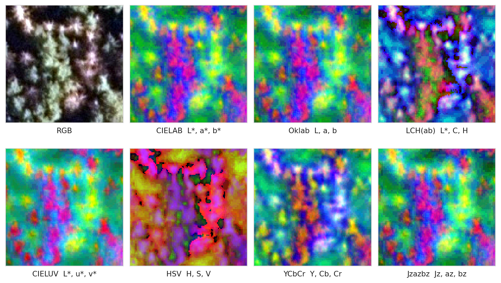

# geopalette


[](https://github.com/igorpawelec/geopalette/actions/workflows/python-tests.yml)
[](https://github.com/igorpawelec/geopalette/actions/workflows/R-CMD-check.yaml)
[](https://github.com/igorpawelec/geopalette/actions/workflows/parity.yml)
[](LICENSE)

**Colour space conversions for geospatial raster data.**

Three RGB bands go in; the components of any of 15 colour spaces come out, as arrays or as a raster. The same conversions in two packages in this repository:

| | Package | Latest | Install |
|---|---|---|---|
| Python | [`pygeopalette`](python/) |  | `pip install --no-deps "git+https://github.com/igorpawelec/geopalette.git#subdirectory=python"` |
| R | [`rgeopalette`](r/) |  | `remotes::install_github("igorpawelec/geopalette", subdir = "r")` |

The two are compared with each other whenever either changes ([parity workflow](.github/workflows/parity.yml)). They agree to better than 1.7e-6 of each component's range. They are not bit-identical and cannot be: pygeopalette stores single precision, and R has no single-precision type.

## The problem it solves

The three bands of an orthophoto are the camera's axes, not the analyst's. Red, green and blue are correlated with each other and with brightness, so a bleached crown in the sun and a healthy one in the shade can differ more along every band than a dead tree differs from a living one. The questions a forester or an image analyst asks — how bright, how saturated, how far towards red — live on other axes, and CIE colorimetry has been describing those axes since 1976.

geopalette moves raster bands onto them. It implements the standard chain — sRGB linearisation (IEC 61966-2-1), CIE XYZ under D65, then CIELAB, CIELUV, their cylindrical LCH forms, DIN99, Oklab, Jzazbz, CIECAM02 and the video and hue-based spaces — with the numerical care a scientific application needs, and checks every space against an independent implementation.



*A 30 × 30 m window of a 0.25 m orthophoto of a spruce stand (`python/test_data/SNP_21_2020_1.tif`) in RGB and in seven of the fifteen spaces, each space's three components shown as the red, green and blue channels and stretched for display. In the opponent spaces — CIELAB, Oklab, CIELUV, Jzazbz — the dead crowns turn magenta, because their `a*` is positive and the living canopy's is negative; the hue-based spaces wrap around the colour circle wherever a pixel is nearly neutral, which is the caveat below made visible. Made by `www/figures.py`.*

## Quick start

Python, on plain NumPy arrays or with `rasterio` for files ([details](python/README.md#installation)):

```python
import numpy as np
from pygeopalette import convertbands, available_spaces

print(available_spaces())
# ['cam02', 'dlab', 'hsi', 'hsl', 'hsv', 'jch', 'jzazbz', 'jzczhz', 'lab', 'lchab', 'lchuv', 'luv', 'oklab', 'xyY', 'ycbcr']

comps, names = convertbands(R, G, B, "lab")     # uint8 bands in; a list of float32 arrays out
print(names)                                    # ['L', 'a', 'b']
```

R, with no required dependencies and `terra` only for files ([details](r/README.md#install)):

```r
library(rgeopalette)

lab <- rgb_to_lab(R, G, B)
lab$L        # 0-100
lab$a        # unbounded

available_spaces()
#> "cam02" "dlab" "hsi" "hsl" "hsv" "jch" "jzazbz" "jzczhz" "lab"
#> "lchab" "lchuv" "luv" "oklab" "xyY" "ycbcr"

comps <- convertbands(R, G, B, "oklab")    # dispatch on a name chosen at runtime
```

The colour spaces, their components and the measured agreement between the two packages are documented in each package's README: [python/README.md](python/README.md), [r/README.md](r/README.md).

## What is where

| Path | Content |
|---|---|
| [`python/`](python/) | `pygeopalette`: the package, its tests, examples and changelog |
| [`r/`](r/) | `rgeopalette`: the package, its tests, `NEWS.md` and the tools that compare it with `pygeopalette` |
| [`.github/workflows/`](.github/workflows/) | `python-tests`, `R-CMD-check` and `parity`, each run only for the folders it covers |

## Releases

Each package is versioned and tagged on its own: `python-vX.Y.Z` and `r-vX.Y.Z`. The tags up to `python-v0.7.1` and `r-v0.2.0` were carried over, with the full history, from the two repositories the packages used to live in, `pygeopalette` and `rgeopalette`.

## Citation

Each package carries its own citation metadata: [python/CITATION.cff](python/CITATION.cff) and [r/CITATION.cff](r/CITATION.cff). The colour science the conversions implement is cited in the [Citation section of the Python README](python/README.md#citation).

## Licence

GNU General Public License v3.0, see [LICENSE](LICENSE).
